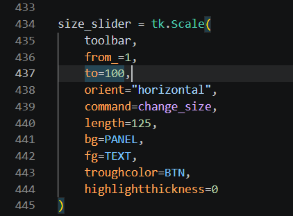
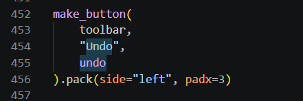
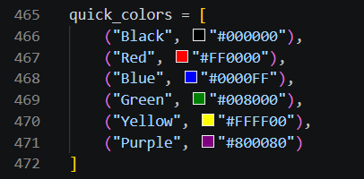
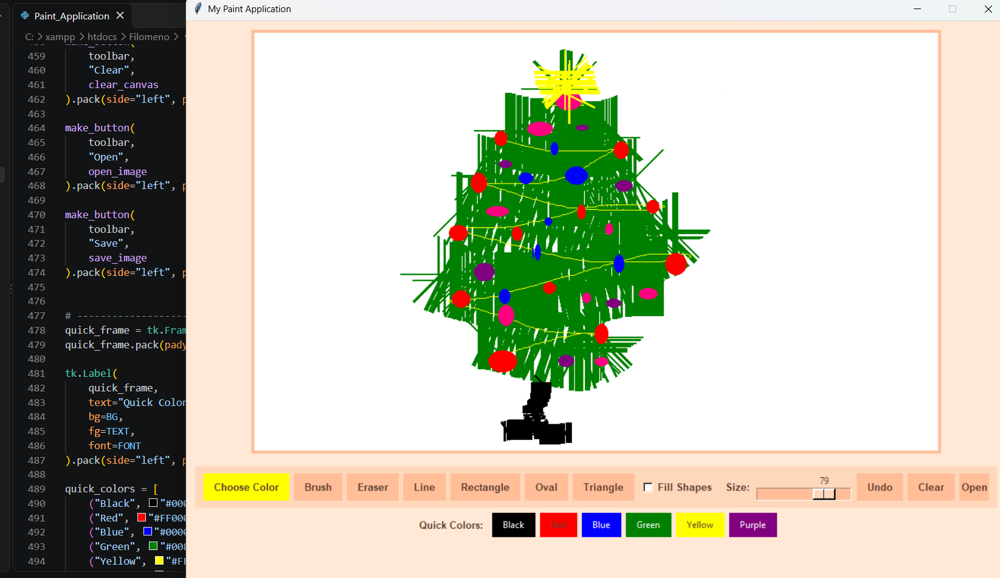

# Paint_Application

## 1. Bigger Brush Range
So, what I did here was adjust the brush size slider to allow a wider range of brush sizes. I made it possible to choose from size 1 up to 100, so the user can draw either thin or thick strokes depending on what they need. This gives more flexibility and control when drawing.

## 2. Undo Button
For the Undo button, I added a function that allows the user to reverse their most recent drawing action. It can undo either a freehand stroke or a shape, making it easier to correct mistakes without removing the entire drawing.

## 3. Filled Shapes
I added a Fill Shapes option that allows rectangles and ovals to be filled with the currently selected color. When the option is enabled, the shapes have a solid interior instead of just an outline.

## 4. Extra Shape Tool (Triangle)
So, what I did for this part was add a Triangle tool alongside the Line, Rectangle, and Oval tools. The user can draw a triangle by dragging on the canvas, and a preview appears while dragging to show the shape before finishing it. The triangle is also included when saving the image.

## 5. Confirm Before Clearing
For the Clear button, I added a confirmation dialog with Yes and No options. This gives the user a chance to confirm before removing their drawing. Choosing Yes clears the canvas, while choosing No cancels the action.

## 6. Quick Colors (Six One-Click Colors)
I also added six quick-color buttons: black, red, blue, green, yellow, and purple. Each button immediately changes the drawing color when clicked, making it quicker to select a color without opening the color picker.

## 7. Screenshot of the Whole UI Design
Below is the screenshot of my Paint Application's complete interface, showing the drawing canvas, toolbar, drawing tools, brush size slider, and quick color buttons.

