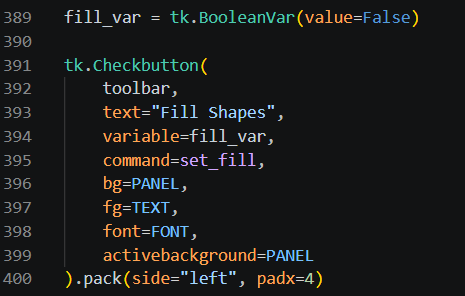
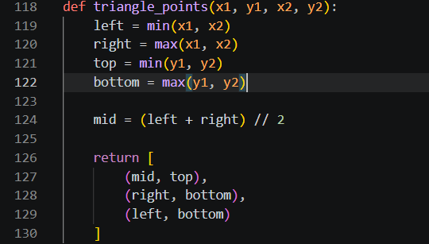
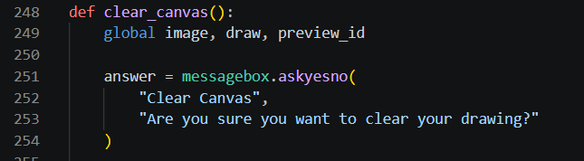

# Paint_Application

## 1. Bigger Brush Range
So, what I did here was adjust the brush size slider. Before, the brush size had a more limited range, so I changed it to go from 1 to 100. This way, the user can choose whether they want a thin line or a much thicker brush, depending on what they're drawing.

## 2. Undo Button
For the Undo button, I added a function that removes the last thing the user drew. So, if they accidentally draw something or make a shape they don't like, they can just click Undo instead of starting all over again.

## 3. Filled Shapes
For this part, I added a Fill Shapes option. When it's checked, rectangles and ovals will have color inside instead of just being outlines. It also uses the color that the user currently selected.

## 4. Extra Shape Tool (Triangle)
I also added a Triangle tool, which is another shape option aside from Line, Rectangle, and Oval. The user can drag on the canvas to make a triangle, and there's a preview while they're drawing so they can see how it looks before finishing.

## 5. Confirm Before Clearing
I made the Clear button ask for confirmation first before removing everything on the canvas. It gives the user Yes and No options, so they can decide whether to clear their drawing or keep it if they clicked the button by accident.

## 6. Quick Colors (Six One-Click Colors)
I added six quick colors: black, red, blue, green, yellow, and purple. Instead of opening the color picker every time, the user can just click the color they want, and it will automatically become the drawing color.

## 7. Screenshot of the Whole UI Design
Here is the screenshot of my Paint Application showing the whole interface, including the canvas, toolbar, drawing tools, brush size slider, and quick colors.

